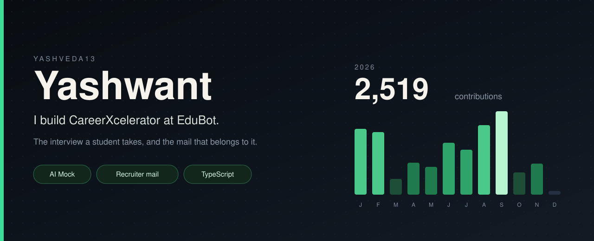

<h3 align="center">AI mock interviews, and the recruiter inbox.</h3>

  I work on CareerXcelerator at EduBot. 
  One side is the interview a student takes. The other is the mail that belongs to that application.

| AI Mock | Recruiter mail | How it is built |
|---|---|---|
| The live interview, the score, and the feedback the student reads when it ends. | The inbox that keeps a note when it names the company and the role, and drops the one that does not. | TypeScript and React on the screen. The API on the other side of it. |

  <code>yashveda13</code>

