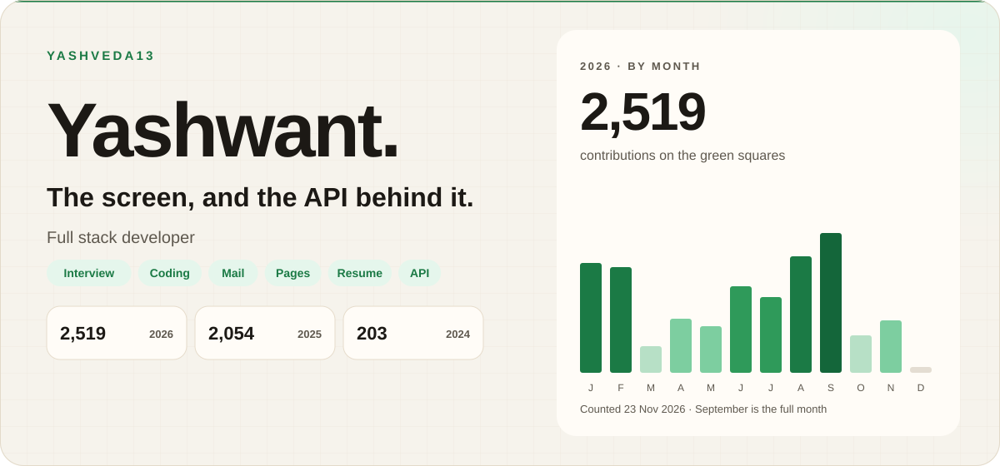
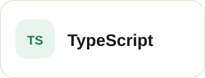
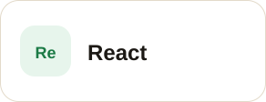
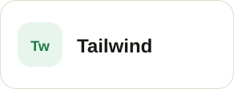
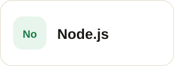
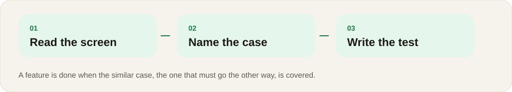
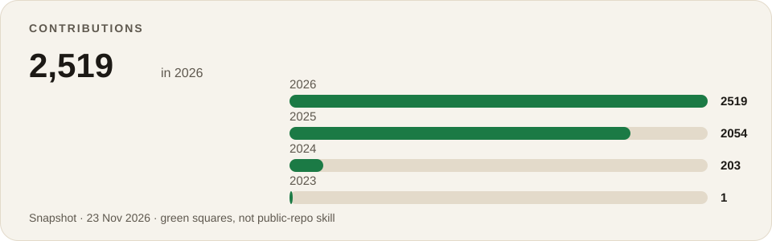

<picture>
  <source media="(max-width: 600px) and (prefers-color-scheme: dark)" srcset="./assets/hero-dark-mobile.svg">
  <source media="(max-width: 600px)" srcset="./assets/hero-light-mobile.svg">
  <source media="(prefers-color-scheme: dark)" srcset="./assets/hero-dark.svg">
  
</picture>

  <a href="#about-me">About</a> &nbsp;·&nbsp;
  <a href="#what-i-can-build">What I can build</a> &nbsp;·&nbsp;
  <a href="#tech-stack">Stack</a> &nbsp;·&nbsp;
  <a href="#lets-connect">Connect</a>

## About me

I’m **Yashwant**, a full stack developer. The screen is TypeScript and React. The API is the other side of the same feature.

I read the screen, name the case that must stay, and write the test for the similar case that must go the other way.

## What I can build

Six things I have shipped. The last line on each card is the case that looks similar and must go the other way.

  <picture>
    <source media="(max-width: 600px) and (prefers-color-scheme: dark)" srcset="./assets/build-dark-mobile.svg">
    <source media="(max-width: 600px)" srcset="./assets/build-light-mobile.svg">
    <source media="(prefers-color-scheme: dark)" srcset="./assets/build-dark.svg">
    
  </picture>

## Tech stack

**Interface**

  <picture><source media="(prefers-color-scheme: dark)" srcset="./assets/stack/typescript-dark.svg"></picture>
  <picture><source media="(prefers-color-scheme: dark)" srcset="./assets/stack/react-dark.svg"></picture>
  <picture><source media="(prefers-color-scheme: dark)" srcset="./assets/stack/tailwindcss-dark.svg"></picture>

**API**

  <picture><source media="(prefers-color-scheme: dark)" srcset="./assets/stack/nodedotjs-dark.svg"></picture>

**Delivery** &nbsp; Git · GitHub Actions

## How I build

**Read the screen. Name the case. Write the test.**

  <picture>
    <source media="(max-width: 600px) and (prefers-color-scheme: dark)" srcset="./assets/method-dark-mobile.svg">
    <source media="(max-width: 600px)" srcset="./assets/method-light-mobile.svg">
    <source media="(prefers-color-scheme: dark)" srcset="./assets/method-dark.svg">
    
  </picture>

## Public code

[Explore my repositories →](https://github.com/yashveda13?tab=repositories)

<picture>
  <source media="(max-width: 600px) and (prefers-color-scheme: dark)" srcset="./assets/github-stats-dark-mobile.svg">
  <source media="(max-width: 600px)" srcset="./assets/github-stats-light-mobile.svg">
  <source media="(prefers-color-scheme: dark)" srcset="./assets/github-stats-dark.svg">
  
</picture>

These are the green squares on the profile, counted on 23 Nov 2026. They include private work. They are not a skill score. [View the snapshot data](./assets/github-stats.json).

## Let’s connect

If you want to talk about a screen, the API behind it, or the case that must go the other way, start here.

**[GitHub](https://github.com/yashveda13)**

<!-- CONTACT_LINKS: When you have a public link, paste it on the next line and delete this comment.
[LinkedIn](REPLACE_LINKEDIN_URL) · [Email](mailto:REPLACE_PUBLIC_EMAIL)
-->

 

<picture>
  <source media="(prefers-color-scheme: dark)" srcset="./assets/footer-dark.svg">
  
</picture>
